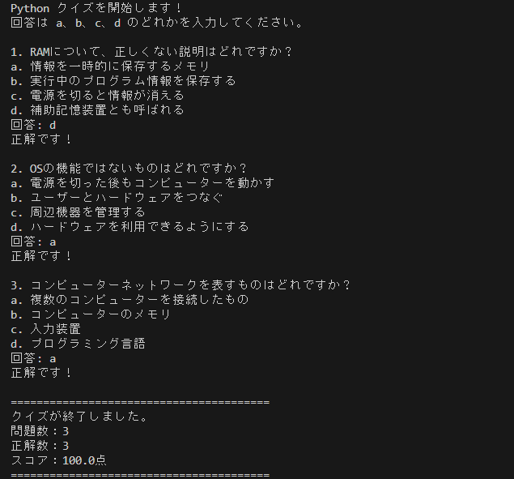
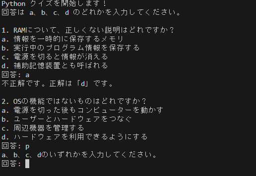

# IT クイズ(Python コンソールアプリ)

Python で作った、a〜d から答えを選ぶ簡単なクイズアプリです。
IT の基礎(RAM、OS、ネットワーク)の問題が出ます。
Python の基礎(クラス、リスト、ループ、入力処理)の学習のために作りました。

## 機能

- 4 択のクイズを 1 問ずつ出題します
- a、b、c、d 以外が入力されたときは、もう一度入力を求めます
- 大文字や前後の空白が入っていても、正しく判定します
- 正解・不正解をすぐに表示します
- 最後に、問題数・正解数・スコアを表示します

## 使用技術

- Python 3

## 実行方法

```bash
python ITquiz.py
```

## 実行例

```
Python クイズを開始します!
回答は a、b、c、d のどれかを入力してください。

1. RAMについて、正しくない説明はどれですか?
a. 情報を一時的に保存するメモリ
b. 実行中のプログラム情報を保存する
c. 電源を切ると情報が消える
d. 補助記憶装置とも呼ばれる
回答: d
正解です!

========================================
クイズが終了しました。
問題数:3
正解数:3
スコア:100.0点
========================================
```

## 実行結果



### 入力チェック

a、b、c、d 以外を入力すると、もう一度入力を求めます。
不正解のときは、正解も表示します。


